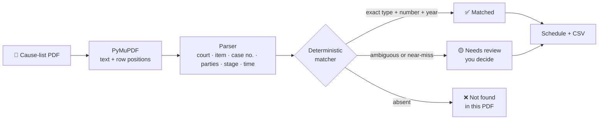

<div align="center">

# ⚖️ CausePulse

### Find · Track · Be Ready

**Turn a court cause-list PDF into your personal hearing schedule — and verify every result against the original page.**


**LIVE DEMO** : ***https://causepluse-warriorhacks-2-0.streamlit.app/***


Built for **WarriorHacks 2.0** · LegalTech track · 24-hour build

<br>


</div>

---

## 📌 The problem

Solo advocates start every court day by scrolling through long **cause-list PDFs**, hunting for their case numbers by eye. It is slow, easy to get wrong, and a missed or mis-read listing has real consequences.

## ✅ The solution

CausePulse does the searching for you, and **never guesses**.

1. **Save** your case numbers once.
2. **Upload** the day's cause-list PDF.
3. **Get** a personalised schedule: court, item number, page, and the hearing time *if it is printed*.
4. **Verify** each match against a highlighted crop of the original PDF page.

Anything ambiguous goes to **Needs Review**, where *you* decide. Nothing is silently chosen.

> ⚠️ **Honest by design.** All bundled sample data is **fictional demo data** (fictional court, parties and judges), clearly labelled in the UI and in the sample PDF. CausePulse works only from the PDF you upload. It is not a live court feed and gives no legal advice.

---

## 🖼️ Screenshots

<table>
  <tr>
    <td align="center" width="50%"><br><b>Needs Review</b><br><sub>Every possible match as its own card, with signals and the original page</sub></td>
    <td align="center" width="50%"><br><b>Hearing Tracker</b><br><sub>Filter by court, status and date · cards or table · CSV export</sub></td>
  </tr>
  <tr>
    <td align="center"><br><b>Case Detail</b><br><sub>Match reasoning, highlighted source row, correct an extraction without re-uploading</sub></td>
    <td align="center"><br><b>Upload Cause List</b><br><sub>Live 3-stage progress, clear errors, entry inspector</sub></td>
  </tr>
  <tr>
    <td align="center"><br><b>My Cases</b><br><sub>Add, edit, bulk import, duplicate detection</sub></td>
    <td align="center"><br><b>Mobile-first</b><br><sub>Bottom navigation and stacked layout on phones</sub></td>
  </tr>
</table>

---

## ⚙️ How it works



**Deterministic Python does the parsing and matching.** The optional AI model is only used for open-ended assistant questions, and it never parses or invents data.

---

## ✨ Features

| Screen | What it does |
|---|---|
| 🏠 **Home** | Greeting, hearing date, 4 metric cards, latest document status, quick actions, personalised schedule, 3D scales hero |
| 📤 **Upload Cause List** | PDF upload (max 20 MB), live 3-stage progress, page count / extraction method / entries, clear errors, entry inspector |
| 📁 **My Cases** | Add / edit / remove / deactivate cases, bulk import, duplicate detection |
| 📅 **Hearing Tracker** | Filters (court, status, search, cause-list date), card and table views, CSV export |
| 🔎 **Needs Review** | Candidate entries with reasons, signal checks, highlighted source page, Confirm / Reject |
| 📑 **Case Detail** | Extracted fields, match reasoning, source evidence (highlighted row + full page), **correct an extraction and re-run matching without re-uploading** |
| 💬 **Assistant** | Answers from the uploaded data only, with source pages; optional LLM for open-ended questions |
| ⚙️ **Settings** | Name, default view, CSV reports, delete documents, clear demo data, reset |

---

## 🛡️ Reliability rules

These are enforced in code and covered by tests.

- **Types, numbers and years are never merged.** `CS/412/2023`, `CS/412/2024` and `CS(COMM)/412/2023` are three different cases.
- **Only an exact type + number + year match is auto-"Matched".** Duplicate numbers, missing type or year, a different case type, one-character near-misses, and court or party conflicts all go to **Needs review**.
- **Hearing time is shown only if it is printed** in the row. Item numbers are listing order, never times.
- **"Not found" means *not found in the uploaded document*.** It never means cancelled or removed.
- **Every entry keeps its page number, source text and row position**, which is what lets the app highlight the original row.
- **Bad files fail clearly.** Scanned or image PDFs, encrypted, corrupt, non-PDF, oversized and unrecognised-layout files produce a clear message, and nothing is saved.
- **Safe exports.** CSV cells are sanitised against spreadsheet formula injection.
- **Secrets stay out of code.** API keys are read only from environment variables or Streamlit secrets.
- **Honest confidence.** Confidence is shown as *signal agreement* (number / year / type / court / parties), not an invented percentage.

### Matching tiers

| Tier | Condition | Result |
|---|---|---|
| 1 | Exact type + number + year (narrowed by your saved court / party names if the number appears more than once) | ✅ Matched |
| 2 | Number matches but your saved case has no type or year | 🟡 Needs review |
| 3 | Same number + year, different case type | 🟡 Needs review |
| 4 | Same type and year, number differs by one character (typo or extraction error, 3+ digits) | 🟡 Needs review |
| 5 | Anything else | ❌ Not found (in this PDF) |

---

## 🚀 Quick start

**Requirements:** Python 3.12 or newer (tested on 3.12 and 3.14).

**macOS / Linux**
```bash
python -m venv .venv && source .venv/bin/activate
pip install -r requirements.txt
streamlit run app.py
```

**Windows (PowerShell)**
```powershell
py -m venv .venv
.venv\Scripts\activate
pip install -r requirements.txt
py -m streamlit run app.py
```

> Run the command from the folder that contains `app.py`.

Open **http://localhost:8501** and click **Load demo data** on Home. You get 8 fictional cases matched against a generated sample cause list:

> **6 matched · 1 needs review · 1 not found**

You can also download the sample PDF from the Upload page.

---

## 🔧 Configuration

All settings are optional.

| Variable | Default | Purpose |
|---|---|---|
| `CAUSEPULSE_STORAGE` | `file` | `file` keeps one local SQLite file. `session` keeps each browser session's data private and in memory (use this for public deployments). |
| `CAUSEPULSE_DB` | `causepulse.db` | Path of the SQLite file in `file` mode. |
| `GROQ_API_KEY` | *(unset)* | Enables the AI model for open-ended assistant questions. |
| `GROQ_MODEL` | `llama-3.3-70b-versatile` | Model used when a key is set. |

Set them as environment variables, in a `.env` file (see `.env.example`), or as Streamlit secrets (see `.streamlit/secrets.toml.example`).

### 💬 The assistant and the optional AI key

Built-in questions work **with no key**, for example:

- *Find my cases listed in Court 3*
- *Show cases that need manual verification*
- *Which saved cases were not found in this PDF?*
- *Explain why entries were marked uncertain*
- *Where is CS/412/2023?*

For free-form questions, set `GROQ_API_KEY`. Only structured records (never the PDF itself) are sent, with instructions to answer strictly from them. Without a key, the assistant lists the questions it can answer.

Never commit keys: `.env` and `.streamlit/secrets.toml` are git-ignored.

---

## 🗂️ Project layout

```
app.py                  shell: sidebar, mobile nav, page router, assistant column
views/                  home, upload, cases, tracker, review, detail, settings
components/             styles.css, justice_3d.html (Three.js), ui.py, nav.py, assistant_panel.py
core/                   normalize, pdf_extractor, case_parser, case_matcher, assistant, exports,
                        source_evidence, sample_data, service, models
database/repository.py  SQLite (saved cases, documents, entries, review decisions, settings)
tests/                  extraction, matching, assistant, headless app workflow
docs/screenshots/       images used in this README
```

`views/` is used instead of `pages/` so Streamlit doesn't auto-generate its own default navigation.

---

## 🧪 Tests

```bash
pip install -r requirements-dev.txt
pytest -q
```

53 tests cover PDF extraction, the matching tiers, the assistant, and a headless end-to-end app workflow.

---

## ☁️ Deployment (Streamlit Community Cloud)

1. Push this folder to a GitHub repo (no secrets in it).
2. Go to **share.streamlit.io** → *New app* → pick the repo, branch, and `app.py`.
3. Under *Advanced settings → Secrets*, add:
   ```toml
   CAUSEPULSE_STORAGE = "session"
   GROQ_API_KEY = ""        # optional
   ```
   Secrets are exposed as environment variables, so `session` mode is picked up automatically.
4. **Why `session`?** In the default `file` mode every visitor shares one SQLite file, and the cloud filesystem is ephemeral. `session` keeps each visitor's cases and documents private and in memory (the demo reloads in one click). For persistent personal use, run locally or on a VM / Docker host with `CAUSEPULSE_STORAGE=file` and a mounted volume.
5. **Docker / VM:**
   ```bash
   pip install -r requirements.txt
   streamlit run app.py --server.port 8501 --server.address 0.0.0.0
   ```

**Smoke test after deploying:** Load demo data → counts read 6 / 1 / 1 → Needs Review → Confirm → download the CSV.

---

## 🚧 Known limits and next steps

- **No OCR.** Scanned PDFs are rejected with a clear message (Tesseract could be added as a fallback).
- **Layout support is specific.** The parser targets row-per-case tables (`item · case no. · parties · stage · time`) under `COURT NO. n` headings, with upper-case case types (`CS`, `CRL.M.C.`, `W.P.(C)`). Other layouts need a parser tweak.
- **3D scales** are built procedurally in Three.js (loaded from cdnjs), with an animated SVG fallback if WebGL or the CDN is unavailable. To use a GLB model instead, load it with `GLTFLoader` in `components/justice_3d.html`.
- **Post-hackathon ideas:** scheduled court scraping, WhatsApp / SMS alerts, accounts, calendar sync.

---

<div align="center">

**Built by Shaik Saniya** · [GitHub @ShaikSaniya67](https://github.com/ShaikSaniya67) · [LinkedIn](https://www.linkedin.com/in/shaiksaniya67)

*CausePulse is a decision-support tool, not legal advice. Always verify against the original cause list.*

</div>
